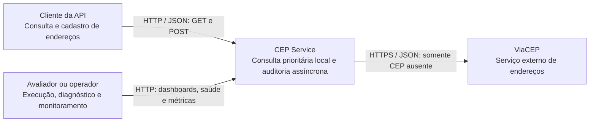
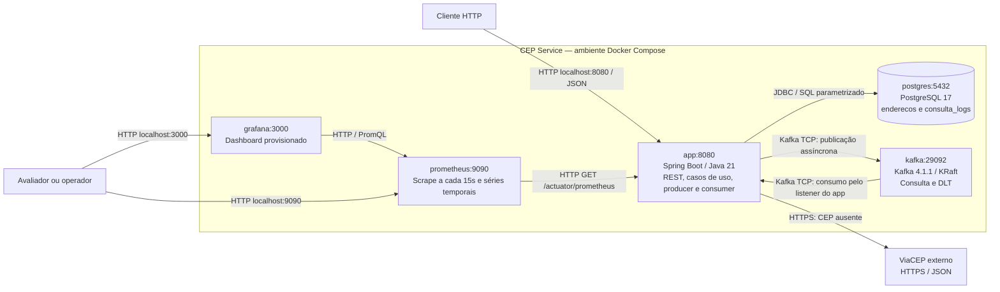
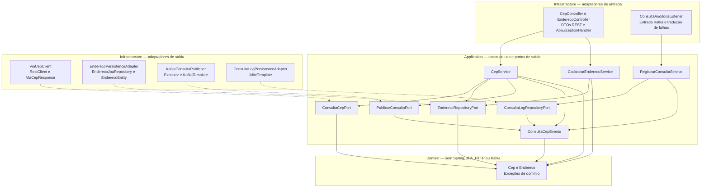
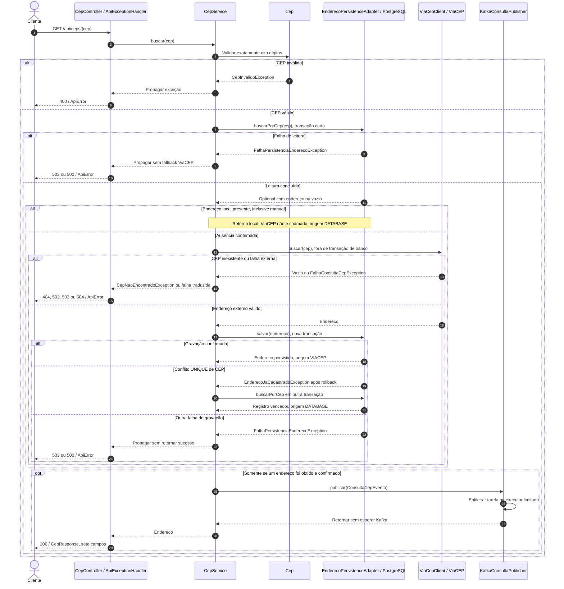
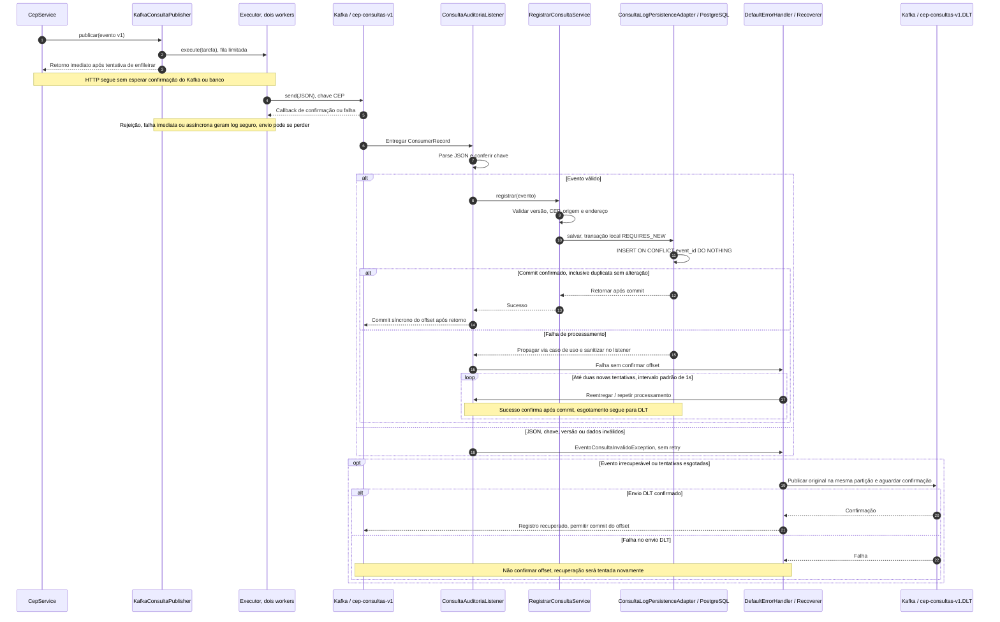
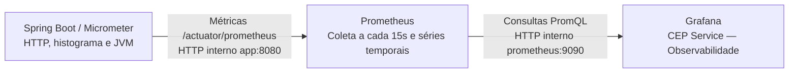

# Arquitetura do CEP Service

[README](../README.md) · [Decisões](decisoes-arquiteturais.md)

Este documento descreve o código e a configuração presentes na revisão `188040b`, base da etapa documental. Os níveis de contexto e containers seguem a decomposição C4, representada com `flowchart` Mermaid; componentes e sequências detalham a implementação. Não exigem plugins, ícones externos ou extensões C4 experimentais. Blocos `mermaid` são renderizados pelo [GitHub](https://docs.github.com/en/get-started/writing-on-github/working-with-advanced-formatting/creating-diagrams).

## A. Contexto — C4 nível 1

O sistema atende clientes HTTP e operadores. PostgreSQL, Kafka e monitoramento são componentes internos da solução, abertos no nível 2; ViaCEP é o serviço externo.

A API aceita oito dígitos e não depende da internet para consultar um cadastro já persistido. A auditoria de sucesso é desacoplada do retorno HTTP e tem os limites de confiabilidade descritos abaixo.

## B. Containers — C4 nível 2

Os cinco serviços estão na mesma rede Compose. As portas publicadas são vinculadas a `127.0.0.1`; os números do diagrama são os padrões. As setas representam chamadas/coletas em execução, não dependências de compilação.

Producer e consumer executam na mesma aplicação Spring Boot: não há microsserviço de auditoria separado. Kafka anuncia também `localhost:9092` para a JVM no host. Os volumes são `postgres_data`, `kafka_data`, `prometheus_data` e `grafana_data`. V1/V2 do Flyway são executadas pelo app antes da validação JPA. KafkaAdmin cria o tópico principal e a DLT, ambos com três partições e uma réplica.

O Compose aguarda saúde de PostgreSQL/Kafka antes do app, do app antes de Prometheus e de Prometheus antes de Grafana. Não são dependências de negócio da API em tempo de execução: por exemplo, parar Grafana não impede uma consulta.

## C. Componentes — arquitetura hexagonal

Neste diagrama, **setas contínuas apontam para dependências usadas no código**. **Setas pontilhadas apontam da implementação para a interface que ela implementa**. A porta não importa o adaptador concreto. A seleção da implementação ocorre em `CepConfiguration`/injeção Spring na infraestrutura.

O diagrama agrupa DTOs, exceções e dependências auxiliares para leitura. Não representa todas as relações entre classes. `ConsultaEventoJson` é compartilhado pelos adaptadores de mensageria e de auditoria; os detalhes Kafka ficam em `KafkaAuditoriaConfiguration`. Controllers dependem dos casos de uso concretos: não foi criada uma interface de entrada sem necessidade.

| Responsabilidade | Evidência no código |
| --- | --- |
| Validar CEP | [Cep](../src/main/java/com/desafio/cep_service/domain/model/Cep.java) |
| Orquestrar DB-first e publicar evento | [CepService](../src/main/java/com/desafio/cep_service/application/usecase/CepService.java) |
| Cadastrar endereço sem sobrescrita | [CadastrarEnderecoService](../src/main/java/com/desafio/cep_service/application/usecase/CadastrarEnderecoService.java) |
| Validar e registrar evento | [RegistrarConsultaService](../src/main/java/com/desafio/cep_service/application/usecase/RegistrarConsultaService.java) |
| Implementar persistência de endereços | [EnderecoPersistenceAdapter](../src/main/java/com/desafio/cep_service/infrastructure/adapter/out/persistence/EnderecoPersistenceAdapter.java) |
| Integrar e traduzir falhas externas | [ViaCepClient](../src/main/java/com/desafio/cep_service/infrastructure/adapter/out/viacep/ViaCepClient.java) |
| Enfileirar publicação fora do HTTP | [KafkaConsultaPublisher](../src/main/java/com/desafio/cep_service/infrastructure/adapter/out/messaging/KafkaConsultaPublisher.java) |
| Receber evento e delegar | [ConsultaAuditoriaListener](../src/main/java/com/desafio/cep_service/infrastructure/adapter/in/messaging/ConsultaAuditoriaListener.java) |
| Gravar auditoria idempotente | [ConsultaLogPersistenceAdapter](../src/main/java/com/desafio/cep_service/infrastructure/adapter/out/persistence/ConsultaLogPersistenceAdapter.java) |

## D. Sequência da consulta de CEP

A validação antecede qualquer I/O. Um registro local pode ter origem manual ou ter sido obtido antes no ViaCEP; o banco não diferencia essas origens. O fluxo de sucesso termina enfileirando a auditoria, sem esperar broker/consumer.

O bloco final só ocorre após sucesso; ramificações de exceção encerram a chamada. Se a releitura após conflito falhar ou não encontrar o registro, o GET retorna erro seguro, não usa o resultado externo descartado. Falha de enfileiramento/publicação é diagnosticada e preserva a consulta concluída.

O POST usa `EnderecoController → CadastrarEnderecoService → EnderecoRepositoryPort`: valida, tenta inserir e responde 201; duplicidade retorna 409. Não executa ViaCEP nem publica auditoria. A prioridade manual resulta de DB-first, não de uma política de sobrescrita.

## E. Sequência da auditoria Kafka

A ordem entre resposta HTTP, confirmação do broker e persistência não é garantida: a resposta não aguarda essas confirmações. A espera pelo envio à DLT ocorre apenas no consumidor.

O loop resume o mecanismo do container: para após sucesso e não exige sempre três tentativas. Violações de integridade do snapshot também são classificadas como evento inválido. A DLT mantém o JSON original e metadados de origem; não possui consumidor automático. Reprocessamento é uma operação controlada, mantendo o `eventId` quando se trata da mesma ocorrência.

Se o processo cair após commit PostgreSQL e antes do offset, o registro pode ser entregue novamente: `UNIQUE(event_id)` e `ON CONFLICT` impedem duplicação da linha. Se cair antes do aceite do broker, o evento em memória pode se perder. Essa combinação **não oferece exactly-once de ponta a ponta**. [Detalhes operacionais e contrato](auditoria-kafka.md).

## F. Observabilidade

As setas abaixo representam o caminho dos dados. As chamadas são iniciadas em sentido inverso: Prometheus faz scrape do app e Grafana consulta Prometheus.

| Painel | Métrica / interpretação |
| --- | --- |
| Volume e requisições/s | `http_server_requests_seconds_count`, com `increase`/`rate` |
| Latência p95 | `histogram_quantile` sobre `http_server_requests_seconds_bucket` |
| Erros 5xx | Proporção de contagens HTTP com status 5xx |
| Disponibilidade | `up{job="cep-service"}`, criado pelo Prometheus |
| Memória JVM | `jvm_memory_used_bytes`, agregada por heap/nonheap |
| CPU do processo | `process_cpu_usage`, quando suportado pelo JVM/ambiente |

Os painéis HTTP excluem `/actuator.*`. Labels usam rotas normalizadas, sem CEP individual, payload ou credenciais. `up` não mede disponibilidade de negócio ou sucesso Kafka; health valida a conexão de banco, mas não comprova auditoria. p95 é aproximado, pode ficar sem valor sem tráfego e não é um SLO. `increase` extrapola o volume. Memória JVM não é memória total do container. Não há métricas próprias de publicação/consumo/DLT nem alertas configurados. [PromQL e validação](monitoramento.md).

## Evidências e leitura complementar

- [Testes de persistência](../src/test/java/com/desafio/cep_service/infrastructure/adapter/out/persistence/EnderecoPersistenceIntegrationTest.java): DB-first, cadastro manual, parâmetros SQL, concorrência e ausência de transação durante HTTP.
- [Testes Kafka](../src/test/java/com/desafio/cep_service/infrastructure/adapter/in/messaging/AuditoriaKafkaIntegrationTest.java): fluxo real Kafka/PostgreSQL, idempotência, retry, DLT e offsets.
- [Testes do producer](../src/test/java/com/desafio/cep_service/infrastructure/adapter/out/messaging/KafkaConsultaPublisherTest.java): execução fora do HTTP e falhas imediatas/assíncronas.
- [Decisões e limites](decisoes-arquiteturais.md).

## Validação desta etapa documental

- Seis diagramas analisados com sucesso pelo parser Mermaid 11.17.2, com ferramenta temporária fora do projeto; nenhuma dependência foi adicionada ao POM.
- Links relativos, sintaxe dos blocos shell e exemplos JSON foram verificados em README e documentos de `docs/`.
- `docker compose config --quiet` e comandos de consulta foram executados sem alterar serviços; os cinco containers estavam healthy.
- Saúde, métricas, readiness Prometheus e saúde Grafana responderam 200. A rota do dashboard redirecionou ao login, conforme autenticação configurada; o provisionamento autenticado tem evidências anteriores em [monitoramento](monitoramento.md).
- PromQL `up{job="cep-service"}` retornou 1; SQL confirmou Flyway V1/V2 aplicadas e nenhum `event_id` duplicado.
- Foram usados como referência os 207 testes anteriormente aprovados, confirmados nos 16 relatórios Surefire locais, sem nova execução da suíte.
- `git diff --check` e conferência de escopo: somente Markdown alterado/criado, sem alterações de negócio, configuração, migrações, Kafka ou credenciais. Nenhum arquivo foi removido.

A validação sintática não equivale a uma inspeção visual de cada diagrama no GitHub. O uso de flowcharts e sequências básicos reduz dependência de recursos específicos do renderizador; a conferência visual no repositório pode ser feita após a aprovação e publicação pelo responsável.
